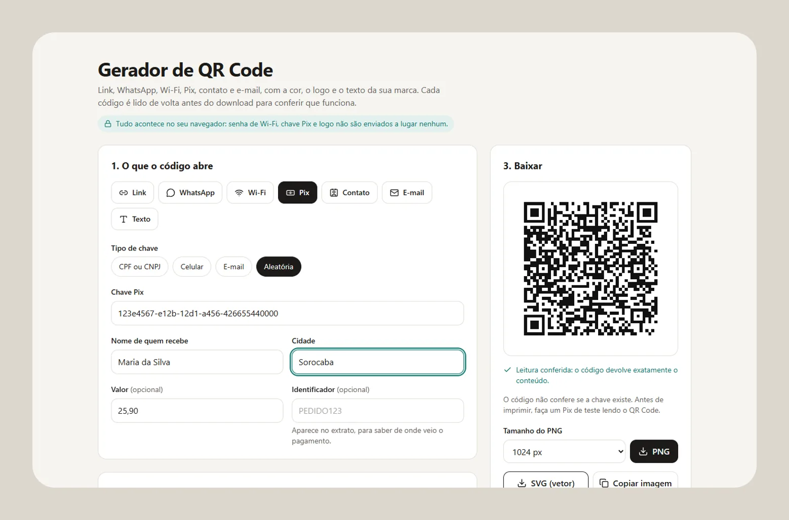
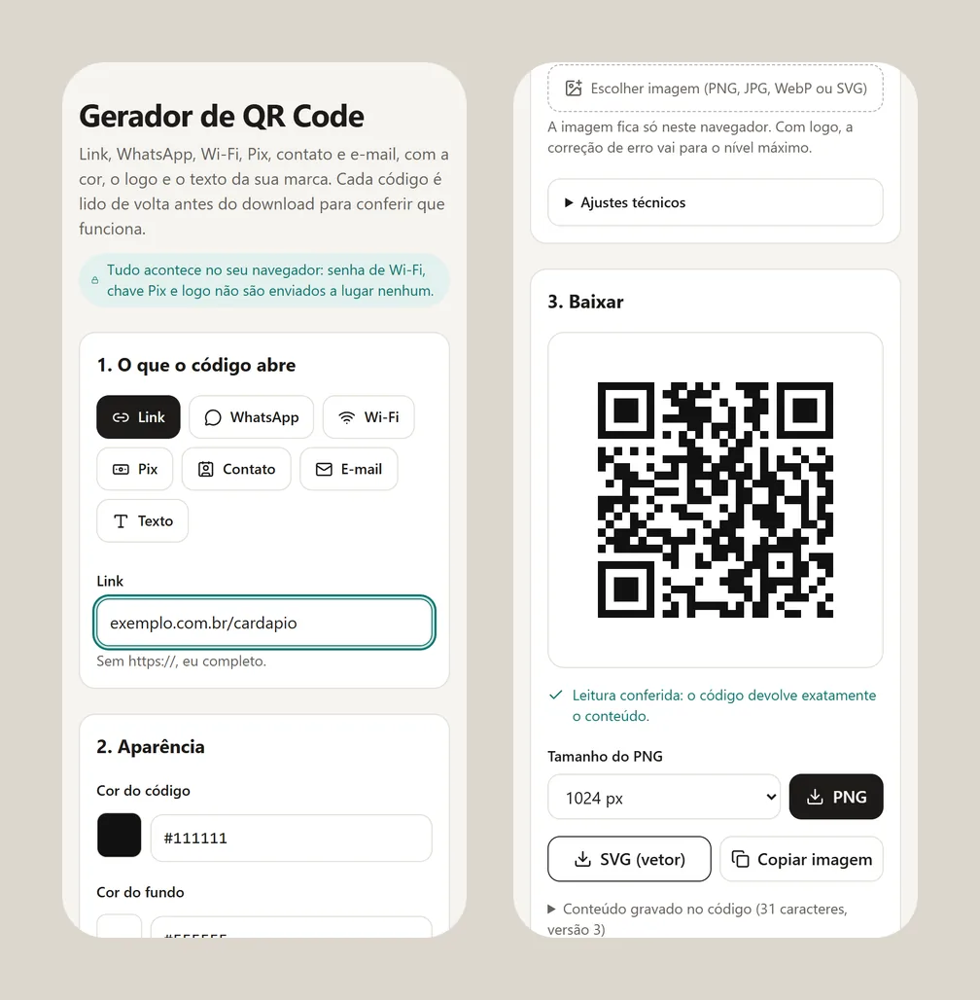

# Gerador de QR Code

QR Code para link, WhatsApp, Wi-Fi, Pix, contato e e-mail, com cor, logo e texto, baixado em PNG ou
SVG. Antes do download, o próprio site lê o código de volta e confere que ele devolve exatamente o
conteúdo digitado.

Tudo roda no navegador. A senha do Wi-Fi, a chave Pix e o logo não saem da página: não há
servidor, nem análise de acesso, nem chamada externa. Os testes de navegador falham se a página
fizer qualquer requisição para fora.



<details>
<summary>No celular</summary>



</details>

A chave Pix da imagem é a chave aleatória de exemplo do manual do Banco Central.

## O que dá para gerar

| Tipo | O que o celular faz ao ler | Cuidados que o formulário já toma |
|---|---|---|
| Link | Abre o site | Completa o `https://`, recusa o que não é link e avisa quando o link é `http` |
| WhatsApp | Abre a conversa com a mensagem escrita | Aceita o número com ou sem 55 e confere o DDD |
| Wi-Fi | Conecta na rede | Escapa `;`, `,`, `:`, `"` e `\` no nome e na senha, e confere o tamanho da senha WPA |
| Pix | Abre o pagamento no banco | Valida os dígitos de CPF e CNPJ, normaliza celular e e-mail, e põe valor e identificador opcionais |
| Contato | Oferece salvar o contato (vCard 3.0) | Separa nome e sobrenome e escapa os caracteres especiais do vCard |
| E-mail | Abre um e-mail pronto | Codifica assunto e mensagem |
| Texto | Mostra o texto | Avisa quando passa do que cabe num QR Code |

O Pix segue o BR Code do Banco Central para QR Code estático. Os testes reproduzem, caractere por
caractere, os exemplos do
[Manual de Padrões para Iniciação do Pix](https://www.bcb.gov.br/content/estabilidadefinanceira/pix/Regulamento_Pix/II_ManualdePadroesparaIniciacaodoPix.pdf).

## Aparência

- Cor do código e do fundo, ou fundo transparente para aplicar sobre uma arte.
- Logo no centro, de 15% a 25% da largura. Com logo, a correção de erro sobe para H, que
  recupera até 30% do código.
- Texto abaixo do código, como "Aponte a câmera para ver o cardápio".
- Nos ajustes técnicos: margem (a norma pede 4 módulos) e nível de correção de erro.

Escolhas que atrapalham a leitura geram aviso: contraste abaixo de 3:1, código claro em fundo
escuro, margem menor que 2 módulos.

## A conferência de leitura

O cálculo não garante que um código com logo e cores próprias vai ler. Por isso, a cada mudança,
o código é desenhado num canvas e lido pelo [jsQR](https://github.com/cozmo/jsQR), como uma
câmera faria. O resultado aparece embaixo da prévia: "Leitura conferida", lido com conteúdo
diferente, ou ilegível. O jsQR só é baixado na primeira conferência, então não pesa no
carregamento da página.

A conferência é feita na imagem gerada, em boas condições. Não substitui testar o material
impresso, no tamanho e na luz em que vai ser usado.

## Como está feito

```
src/conteudo/     monta o texto de cada tipo (link, Wi-Fi, vCard, Pix...) e valida os campos
src/desenho/      matriz, layout, SVG, PNG, contraste e conferência de leitura
src/componentes/  interface em React
tests/            Vitest: formatos, documentos, Pix, layout e contraste
e2e/              Playwright: gerar, conferir e baixar no celular e no desktop
```

- **Um layout, dois arquivos.** O SVG e o PNG saem do mesmo cálculo de posições. No PNG, cada
  módulo cai em pixels inteiros, para não aparecer linha clara entre quadrados vizinhos.
- **SVG enxuto.** Módulos escuros vizinhos na mesma linha viram uma faixa só, em vez de um
  quadrado por módulo.
- **Texto do usuário escapado.** A legenda e as cores entram no SVG com escape de XML; há teste
  para isso.
- **Política de segurança restrita.** O `vercel.json` só permite recursos do próprio domínio (e
  imagens `data:` e `blob:`, usadas pela prévia e pelo logo). O `vite preview` usa os mesmos
  cabeçalhos, então os testes de navegador rodam sob a política de produção.

## Rodando

Precisa do Node 22.12 ou mais novo.

```bash
npm install
npm run dev
```

```bash
npm test            # Vitest
npm run test:e2e    # Playwright, celular e desktop
npm run lint
npm run build       # verifica os tipos e gera dist/
```

Na primeira vez, `npx playwright install chromium` baixa o navegador dos testes. Com o Chrome
instalado, `PW_CHANNEL=chrome npm run test:e2e` usa ele.

## Limitações

- **QR Code estático.** O destino fica gravado no desenho. Para trocar o link depois de impresso,
  ou contar leituras, é preciso um QR dinâmico, que aponta para um servidor de redirecionamento.
  Esse servidor não existe aqui, de propósito, para nada sair do navegador.
- **Pix sem confirmação.** O código não sabe se a chave existe nem avisa quando o pagamento cai.
  Antes de imprimir, vale fazer um Pix de teste.
- **Leitura em boas condições.** A conferência usa a imagem digital, sem desfoque, reflexo ou
  distância.
- **Aviso do `npm audit`.** O `picomatch`, usado pelo Vite e pelo Vitest durante o
  desenvolvimento, tem um alerta de ReDoS
  ([GHSA-fc5q-39xc-vjpf](https://github.com/advisories/GHSA-fc5q-39xc-vjpf)) ainda sem versão
  corrigida. Ele não vai para o site publicado.

## Histórico

Começou em 2022 com Create React App, gerando PNG a partir de um texto. Migrei para Vite e React
19 quando o CRA deixou de ser mantido, e depois para TypeScript, com os tipos de conteúdo, a
aparência e a conferência de leitura.
